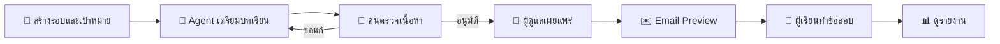

<div align="center">
  

  <h1>🛡️ AwareFlow</h1>

  <p><strong>AI Agent สำหรับจัดการ Security Awareness ตั้งแต่บทเรียนถึงรายงาน</strong></p>
  <p>🐍 Python · 🎨 Streamlit · 🗃️ SQLite · 🤖 AI Agent · 🇹🇭 รองรับภาษาไทย</p>
  <p><a href="#quick-start">เริ่มใช้งาน</a> · <a href="#agent">รู้จัก Agent</a> · <a href="#providers">เชื่อมต่อโมเดล</a> · <a href="#documentation">เอกสารเพิ่มเติม</a></p>
</div>

---

AwareFlow เป็น **ต้นแบบระบบอบรมความตระหนักด้านความปลอดภัยไซเบอร์** ตาม [FLOW.md](FLOW.md) ช่วยสร้างบทอ่านและข้อสอบ ส่งให้คนตรวจและอนุมัติ เผยแพร่ให้ผู้เรียน แล้วติดตามผลผ่าน dashboard และรายงาน

เริ่มทดลองได้ด้วย **Mock Mode โดยไม่ต้องมี API key** และใช้อีเมลแบบ Preview ก่อนเชื่อมต่อบริการภายนอก ข้อมูลเก็บในเครื่องและคงอยู่หลังรีเฟรชหรือเปิดแอปใหม่

> 🧪 **สถานะ: Prototype / Demo** — ระบบใช้บัญชีสาธิตแบบเลือกชื่อ ยังไม่มี SSO หรือ authentication สำหรับพนักงานจริง แม้เชื่อมต่อโมเดลภายนอกแล้วก็ตาม

## 🧭 สารบัญ

- [✨ ความสามารถหลัก](#features)
- [🚀 เริ่มใช้งาน](#quick-start)
- [🎮 ทดลองใช้งานครบวงจร](#demo)
- [🤖 Agent ทำงานอย่างไร](#agent)
- [🔌 เชื่อมต่อโมเดลและบริการภายนอก](#providers)
- [⚙️ การตั้งค่าที่ควรรู้](#configuration)
- [⏱️ Worker และ Scheduler](#background-jobs)
- [🧪 ตรวจสอบโปรเจกต์](#verification)
- [🗂️ โครงสร้างและเอกสาร](#documentation)
- [📌 ขอบเขตของต้นแบบ](#limitations)

<a id="features"></a>

## ✨ ความสามารถหลัก

| ส่วนงาน | สิ่งที่ทำได้ |
| --- | --- |
| 🤖 **AI Agent** | ค้นข้อมูล เขียนและแก้ร่าง ตรวจเนื้อหา/PDF และขอข้อมูลเพิ่ม พร้อมบันทึกประวัติการใช้เครื่องมือ |
| 📚 **บทเรียนและข้อสอบ** | ตรวจรูปแบบข้อมูลด้วย typed schema สร้าง PDF ภาษาไทยหนึ่งหน้า และเก็บเนื้อหาทุกเวอร์ชัน |
| ✅ **ตรวจและอนุมัติ** | ขอแก้ อนุมัติ และเผยแพร่โดยผู้มีสิทธิ์ พร้อมประวัติการอนุมัติและป้องกันคำสั่งซ้ำจากหน้าจอเก่า |
| 👥 **ผู้ใช้และรอบอบรม** | จัดการผู้ใช้ กลุ่ม บริบทองค์กร และกำหนดการรายเดือน/รายปี พร้อมพักกำหนดการได้ |
| 📝 **การสอบ** | ลิงก์ลงนามและ submission tickets ตรวจคำตอบด้วยโค้ด รองรับสอบซ้ำ และเก็บผลครั้งแรก/ครั้งล่าสุด |
| ✉️ **อีเมล** | Preview เป็นไฟล์ EML แนบ PDF และลิงก์รายบุคคล หรือส่งผ่าน SMTP ที่เปิดใช้งานและกำหนดผู้รับไว้ชัดเจน |
| 📊 **รายงาน** | Dashboard รายรอบ/รายปี ส่งออก CSV ภาษาไทยและ PDF พร้อมเก็บ snapshot ถาวร |
| 🔄 **งานเบื้องหลัง** | Worker มี heartbeat, lease recovery และ retry แบบเพิ่มช่วงเวลารออย่างมีขีดจำกัด |

การเผยแพร่จะตรึงเวอร์ชันเนื้อหา เกณฑ์สอบ กำหนดส่ง และรายชื่อผู้เรียนใน transaction เดียว รายงานใช้ตัวเลขที่คำนวณจากฐานข้อมูล ส่วน AI summary เลือกประเด็นจาก schema ที่จำกัด แล้วให้ระบบใส่ตัวเลขเอง พร้อมใช้ template เมื่อ AI ใช้ไม่ได้

<a id="quick-start"></a>

## 🚀 เริ่มใช้งาน

### 1. เตรียมโปรเจกต์

โปรเจกต์ระบุ **Python 3.9 ขึ้นไป** ใน `pyproject.toml` โดยบันทึกการพัฒนาเดิมใช้ Python 3.9.6 คำสั่งต่อไปนี้สำหรับ **macOS / Linux**:

```bash
git clone git@github.com:Ampsoria/AwareFlow-with-Ai-Agent.git
cd AwareFlow-with-Ai-Agent

python3 -m venv .venv
.venv/bin/python -m pip install --upgrade pip
.venv/bin/python -m pip install -r requirements.lock
.venv/bin/python -m pip install -e '.[qa]'
```

หากมี source อยู่แล้ว ให้เปิด terminal ที่ root ของโปรเจกต์แล้วเริ่มจากขั้นตอนสร้าง virtual environment

### 2. เตรียมไฟล์ตั้งค่า

สร้าง `.env` จากไฟล์ตัวอย่างเมื่อยังไม่มีไฟล์นี้:

```bash
if [ ! -f .env ]; then
  cp .env.example .env
fi
```

สำหรับการทดลองแบบ Mock ให้ใช้ค่าต่อไปนี้ใน `.env`:

```dotenv
LLM_PROVIDER=mock
SEARCH_PROVIDER=mock
EMAIL_TRANSPORT=preview
EMAIL_REAL_SEND_ENABLED=false
```

🔐 `.env` ถูกยกเว้นจาก Git ส่วน [`.env.example`](.env.example) ใช้เป็นแม่แบบที่ไม่มีคีย์จริง แอปอ่าน `.env` อัตโนมัติ โดยค่าจาก environment ของ process มีลำดับสูงกว่า

### 3. เปิดแอป

```bash
.venv/bin/streamlit run app.py
```

เปิด **[http://localhost:8501](http://localhost:8501)** เลือก **ADMIN** ที่แถบซ้าย แล้วโหลดข้อมูลตัวอย่างจากหน้า **ภาพรวม** หรือเริ่มสร้างรอบเองที่หน้า **รอบอบรม**

📁 เมื่อ LLM และ search เป็น Mock ทั้งคู่ ข้อมูลจะเก็บใน `var/demo/` ค่าเริ่มต้นเปิดเว็บเฉพาะเครื่องที่รัน ลิงก์ localhost ในอีเมลจึงใช้ได้บนเครื่องนั้นเท่านั้น

<a id="demo"></a>

## 🎮 ทดลองใช้งานครบวงจร



1. **สร้างรอบอบรม** และระบุเป้าหมายที่ต้องการให้ Agent ทำ
2. **ให้ Agent เตรียมชุดอบรม** แล้วกดประมวลผลงานจากหน้าจอได้โดยไม่ต้องเปิด worker แยก
3. **ตรวจประวัติเครื่องมือ บทอ่าน และข้อสอบ** ขอแก้ไขได้ก่อนอนุมัติ
4. **อนุมัติและเผยแพร่** แล้วตรวจไฟล์ในหน้าอีเมลแบบ Preview
5. **เปลี่ยนเป็น TEST001–TEST005** เพื่อทดลองทำข้อสอบ
6. **กลับมาเป็น ADMIN** เพื่อดูผลและส่งออกรายงาน

### 📊 ข้อมูลตัวอย่าง

| รายการ | ค่าจำลอง |
| --- | --- |
| ผู้เรียนทั้งหมด | 5 คน |
| ทำแล้ว / ยังไม่ทำ | 4 / 1 คน |
| ผ่าน / ไม่ผ่าน | 3 / 1 คน |
| อัตราทำครบ / อัตราผ่านของผู้ทำแล้ว | 80% / 75% |
| คะแนนเฉลี่ยครั้งล่าสุด / ครั้งแรก | 80% / 70% |
| ส่งทันกำหนด / ล่าช้า | 3 / 1 คน |

ข้อมูลนี้เป็น fixture จำลอง ไม่ใช่ข่าวหรือผลสอบจริง ปุ่มตัวอย่างใน UI วางรอบย้อนหลังจากวันที่โหลดครั้งแรก เรียกซ้ำไม่สร้างผลซ้ำและไม่ล้างรอบที่สร้างเอง ส่วน CLI demo ใช้วันที่ fixture เดือนตุลาคม 2026 คงที่

<a id="agent"></a>

## 🤖 Agent ทำงานอย่างไร

แกนการทำงานอยู่ที่ [`application/agent.py`](src/awareflow/application/agent.py) โมเดลเลือกเครื่องมือเพื่อค้นแหล่งข้อมูล เขียนหรือแก้ร่าง ตรวจร่างและ PDF หรือหยุดขอข้อมูลเพิ่มตามผลที่ได้รับ เมื่อพร้อมแล้วจึงส่งให้คนตรวจ

- 🧰 **ตรวจสอบย้อนหลังได้:** ประวัติการเรียกเครื่องมือเก็บในฐานข้อมูล และเปิดดูจากหน้า “รอบอบรม”
- 👤 **คนเป็นผู้ตัดสินใจ:** Agent ไม่มีสิทธิ์อนุมัติ เผยแพร่ หรือส่งเมลเอง
- 🧪 **Mock Mode:** จำลองการเลือกเครื่องมือ และเพิ่มตัวอย่างตามรูปแบบที่กำหนดเมื่อขอแก้ ไม่ได้ตีความ feedback ด้วยโมเดลจริง
- 🔌 **Connected Mode:** ใช้ adapter ของ provider ที่เลือก และตรวจ schema/สิทธิ์ก่อนรันเครื่องมือ

| ขีดจำกัดต่อหนึ่ง attempt | ตัวแปร | ค่าเริ่มต้น |
| --- | --- | --- |
| จำนวนขั้นทั้งหมด | `AGENT_MAX_STEPS` | 12 |
| จำนวนครั้งที่ค้นข้อมูล | `AGENT_MAX_SEARCHES` | 5 |
| จำนวนครั้งที่เขียนหรือแก้ร่าง | `AGENT_MAX_DRAFTS` | 3 |

เมื่อถึงขีดจำกัด ระบบจะขอข้อมูลจากผู้ดูแล ดูแผนภาพและสัญญาเครื่องมือเพิ่มเติมใน [คู่มือ Agent](docs/AGENT.md)

<a id="providers"></a>

## 🔌 เชื่อมต่อโมเดลและบริการภายนอก

### 🧠 เลือก LLM Provider

| ค่า `LLM_PROVIDER` | ใช้กับ | ไฟล์ตัวอย่าง |
| --- | --- | --- |
| `mock` | ทดลองโดยไม่เรียกโมเดลภายนอก | [ค่าเริ่มต้น](.env.example) |
| `gemini` | Gemini | [Gemini](examples/env/gemini.env.example) |
| `openai` | OpenAI | [OpenAI](examples/env/openai.env.example) |
| `anthropic` | Claude | [Anthropic](examples/env/anthropic.env.example) |
| `openai_compatible` | API แบบ OpenAI-compatible เช่น LM Studio/vLLM | [Compatible](examples/env/openai_compatible.env.example) |
| `ollama` | โมเดลที่ให้บริการผ่าน Ollama | [Ollama](examples/env/ollama.env.example) |
| `company` | API บริษัทผ่าน custom factory | [ตัวอย่าง adapter](examples/company_adapter.py) |

แก้ค่าจากไฟล์ตัวอย่างลงใน **`.env` ที่ root โปรเจกต์** โดยตั้ง `LLM_MODEL` เป็นชื่อโมเดลที่บัญชีหรือเซิร์ฟเวอร์ของคุณใช้งานได้จริง ตัวอย่างเช่น Gemini ต้องตั้ง `LLM_PROVIDER=gemini` พร้อม `GEMINI_API_KEY` และ `LLM_MODEL`

`LLM_API_KEY` ที่มีค่าจะใช้แทนคีย์ราย provider จึงควรเว้นว่างเมื่อใช้ช่องอย่าง `GEMINI_API_KEY` หลังเปลี่ยนค่าให้ **restart ทั้งเว็บและ worker** แล้วตรวจการเชื่อมต่อด้วย:

```bash
.venv/bin/python -m awareflow.cli check-llm
```

คำสั่งนี้ส่งข้อความทดสอบสองครั้งไปยัง provider ที่เลือกเพื่อตรวจ JSON และการเลือกเครื่องมือ โดยไม่รันเครื่องมือหรือส่งอีเมล การผ่านคำสั่งนี้ยังไม่ใช่การรับรองคุณภาพบทเรียนทุกหัวข้อ

ดูขั้นตอนและรูปแบบ endpoint ใน [คู่มือ Providers](docs/PROVIDERS.md) รวมถึง [ตัวอย่างการเชื่อมต่อผ่าน LAN](examples/env/lan.env.example) HTTP บน localhost รองรับโดยอัตโนมัติ ส่วน HTTP บน LAN ต้องตั้ง `LLM_ALLOW_INSECURE_HTTP=true` อย่างชัดเจน

### 🔎 ค้นข้อมูลด้วย Tavily

ตั้ง `SEARCH_PROVIDER=tavily` พร้อม `SEARCH_API_KEY` และระบุ `SEARCH_ENDPOINT` ได้หากต้องใช้ URL ของ search endpoint อื่น ระบบจำกัด domains และไม่ให้ LLM ประดิษฐ์แหล่งอ้างอิง

หากยังใช้ `SEARCH_PROVIDER=mock` แหล่งข้อมูลจะยังเป็นข้อมูลจำลองแม้เชื่อมต่อ LLM จริงแล้ว

> 🗓️ วันที่จาก Tavily เก็บเป็น `provider_date` ซึ่งอาจเป็นวันเผยแพร่หรือวันแก้ไข โหมด `recent` จะเข้า `NEEDS_INPUT` หากไม่มีวันที่เผยแพร่/เกิดเหตุที่ยืนยัน ใช้ `evergreen` เพื่อทบทวนความรู้ หรือเพิ่ม search adapter ที่ยืนยันวันที่ได้ก่อนใช้เป็นข่าวล่าสุด

### ✉️ ส่งอีเมลด้วย SMTP

ตั้ง `EMAIL_TRANSPORT=smtp`, `EMAIL_REAL_SEND_ENABLED=true`, `SMTP_HOST`, `SMTP_FROM`, ค่า TLS และ `EMAIL_TEST_ALLOWLIST` เป็นอีเมลคั่นด้วย comma จากนั้นเตรียมและกดส่งในหน้าอีเมล

แก้อีเมลผู้ใช้ให้ถูกต้อง **ก่อนเผยแพร่** เพราะ assignment เก็บ recipient snapshot หากผลการส่งไม่แน่นอน ระบบจะตั้งสถานะ `UNKNOWN` ให้ตรวจผลและบันทึกการตัดสินใจก่อน retry โดยไม่ส่งซ้ำอัตโนมัติ

<a id="configuration"></a>

## ⚙️ การตั้งค่าที่ควรรู้

| ตัวแปร | การใช้งาน |
| --- | --- |
| `DATA_ROOT` / `DATABASE_PATH` | ที่เก็บไฟล์และฐานข้อมูล ค่าอัตโนมัติคือ `var/demo` เมื่อ LLM/search เป็น Mock ทั้งคู่ หรือ `var/connected` เมื่อใช้ provider จริง |
| `APP_BASE_URL` | URL หน้าเว็บที่ใช้สร้างลิงก์ในอีเมล ค่าเริ่มต้นคือ `http://localhost:8501` |
| `APP_SIGNING_SECRET` | เว้นว่างได้ ระบบสร้าง secret ใน `DATA_ROOT/.signing-secret` ด้วยสิทธิ์ `0600`; เก็บคู่กับ DB เพื่อให้ลิงก์เก่าใช้ได้ |
| `LLM_ENDPOINT` | API base URL ของโมเดล ดูรูปแบบของแต่ละ provider ในคู่มือ |
| `COMPANY_ADAPTER_FACTORY` | Factory รูปแบบ `package.module:build_llm` สำหรับ API บริษัท |
| `COMPANY_API_ENDPOINT` / `COMPANY_CREDENTIAL_ENV` | Endpoint และชื่อตัวแปร credential ของบริษัท แยกจากการตั้งค่า provider อื่น |
| `APP_MODE` / `AUTH_PROVIDER` | รุ่นนี้รองรับ `demo` / `demo_selector` |
| `APP_TIMEZONE` | รุ่นนี้รองรับ `Asia/Bangkok` |

หากกำหนด `DATA_ROOT` / `DATABASE_PATH` เองแล้วสลับระหว่าง Mock และ Connected ให้ **ใช้เส้นทางใหม่ทั้งคู่** ระบบปฏิเสธการปนชุดข้อมูล ส่วน company adapter ต้องเติม request/response mapping ตามสเปกบริษัทก่อนใช้งาน

ค่าและคำอธิบายทั้งหมดอยู่ใน [`.env.example`](.env.example) เก็บ secrets ฝั่งเซิร์ฟเวอร์เท่านั้น

<a id="background-jobs"></a>

## ⏱️ Worker และ Scheduler

เปิดแต่ละคำสั่งใน terminal แยกกัน โดยใช้ environment และ `DATA_ROOT` เดียวกับหน้าเว็บ:

```bash
# ประมวลผลคิวงาน
.venv/bin/python -m awareflow.cli worker --interval 5
```

```bash
# ตรวจและสร้างงานตามกำหนดการ
.venv/bin/python -m awareflow.cli scheduler --interval 30
```

แต่ละคำสั่งรันต่อเนื่องจนกด `Ctrl+C` เครื่องต้องเปิดอยู่ Scheduler สร้างรอบฉบับร่างและรายงานตามกำหนดการ โดยไม่อนุมัติ เผยแพร่ หรือส่งเมลแทนผู้ดูแล ยังไม่ได้ติดตั้งเป็น system service

### 🛠️ คำสั่งแบบเรียกครั้งเดียว

| คำสั่ง | หน้าที่ |
| --- | --- |
| `init-db` | เตรียมฐานข้อมูลและผู้ใช้สาธิต โดยเก็บข้อมูลเดิมไว้ |
| `worker-once` | ประมวลผลงานจากคิวหนึ่งครั้ง |
| `scheduler-once` | ตรวจงานตามกำหนดการหนึ่งครั้ง |
| `demo` | รัน workflow ตัวอย่างผ่าน CLI |
| `check-llm` | ตรวจ JSON และการเลือกเครื่องมือของโมเดลที่ตั้งค่าไว้ |

ใช้รูปแบบ `.venv/bin/python -m awareflow.cli <คำสั่ง>` เช่น:

```bash
.venv/bin/python -m awareflow.cli demo
```

<a id="verification"></a>

## 🧪 ตรวจสอบโปรเจกต์

รันจาก root หลังติดตั้ง dependencies และชุด `qa`:

```bash
.venv/bin/python -m unittest discover -s tests -v
.venv/bin/python scripts/check_schema.py
.venv/bin/python -m pip check
```

ชุดทดสอบครอบคลุม Agent decisions/tools/guards, core/concurrency, integrations จำลอง, PDF และ Streamlit AppTest ส่วน UI test เดินตั้งแต่ขอแก้ อนุมัติ เผยแพร่ ไปจนถึงส่งข้อสอบและออกรายงาน พร้อมสคริปต์ตรวจ schema แยกต่างหาก

<a id="documentation"></a>

## 🗂️ โครงสร้างและเอกสาร

```text
AwareFlow-with-Ai-Agent/
├── app.py                  # จุดเริ่มต้น Streamlit
├── src/awareflow/
│   ├── application/        # Agent และ workflow services
│   ├── domain/             # Models, schema และกติกาโดเมน
│   ├── infrastructure/     # Database, LLM, PDF และ email adapters
│   └── ui/                 # หน้าผู้ดูแล ผู้ตรวจ และผู้เรียน
├── db/migrations/          # โครงสร้างและ migrations ของ SQLite
├── examples/               # ตัวอย่าง provider config และ company adapter
├── tests/                  # ชุดทดสอบ
├── scripts/                # เครื่องมือตรวจ schema
├── assets/                 # ฟอนต์สำหรับ PDF
├── static/                 # โลโก้และฟอนต์หน้าเว็บ
├── docs/                   # คู่มือและรายละเอียดระบบ
├── .env.example            # แม่แบบการตั้งค่า
└── requirements.lock       # Dependencies ที่ระบุเวอร์ชัน
```

| เอกสาร | เนื้อหา |
| --- | --- |
| 🧭 [FLOW.md](FLOW.md) | ภาพรวมกระบวนการและขอบเขตงาน |
| 🤖 [AGENT.md](docs/AGENT.md) | แกน Agent เครื่องมือ ขอบเขต และการเชื่อมโมเดล |
| 🔌 [PROVIDERS.md](docs/PROVIDERS.md) | ตั้งค่า provider, endpoint และโมเดลบนเครือข่าย |
| 🧩 [CORE_GUIDE.md](docs/CORE_GUIDE.md) | โครงสร้าง services และฐานข้อมูล |
| 🏗️ [ARCHITECTURE.md](docs/ARCHITECTURE.md) | กติกาธุรกิจและการออกแบบระบบ |
| 📋 [CONTRACTS.md](docs/CONTRACTS.md) | สัญญาข้อมูลและ integrations |
| 🔬 [IMPLEMENTATION_NOTES.md](docs/IMPLEMENTATION_NOTES.md) | บันทึกการทดสอบและข้อจำกัด |
| 🤝 [SOL_HANDOFF.md](docs/SOL_HANDOFF.md) | สถานะส่งต่องานและข้อที่ต้องรักษา |

<a id="limitations"></a>

## 📌 ขอบเขตของต้นแบบ

- **บัญชีผู้ใช้ยังเป็น Demo:** ต้องเพิ่ม authentication ที่เหมาะสมก่อนใช้ข้อมูลพนักงานจริง
- **การเชื่อมต่อภายนอกต้องทดสอบกับระบบที่ใช้งาน:** มี adapter และชุดทดสอบผ่าน transport จำลอง แต่ผลดังกล่าวไม่ยืนยันการเชื่อมต่อ API/SMTP จริงของคุณ
- **ติดตั้งจาก source แบบ editable:** ยังไม่ได้จัดแพ็กเกจ standalone wheel หรือ deployment สำหรับ production
- **แชร์ข้ามเครื่องต้องตั้งค่าเพิ่มเติม:** กำหนด host/base URL และระบบยืนยันตัวตนให้เหมาะสมก่อนเปิดให้ผู้อื่นเข้าถึง
