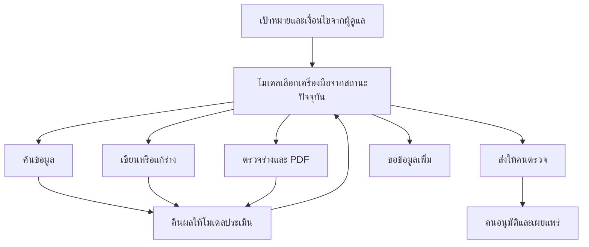

# AwareFlow Agent

รุ่นนี้เปลี่ยนส่วนสร้างเนื้อหาจากลำดับตายตัวเป็น **Agent หนึ่งตัวที่ให้โมเดลเลือกเครื่องมือ** ตามคำขอเพิ่มเติมของผู้ใช้ ส่วนระบบรอบอบรม การอนุมัติ การสอบ และรายงานยังใช้ services เดิม

## เริ่มจากไฟล์ไหน

- `src/awareflow/application/agent.py`: AwarenessAgent วน observe → model decision → ตรวจคำสั่ง → execute tool → observation จนส่งร่างให้คนหรือหยุดขอข้อมูล
- `src/awareflow/domain/agent.py`: รายชื่อเครื่องมือ schema ของ arguments และ system instructions
- `src/awareflow/infrastructure/providers.py`: OpenAILLM.decide_agent ใช้ Responses API native function calling; generate ใช้ structured output สำหรับบทเรียน
- `src/awareflow/infrastructure/mock.py`: ตัวจำลองการเลือกเครื่องมือแบบ deterministic สำหรับการทดสอบ ไม่มีการอ้างว่าเป็น AI reasoning
- `src/awareflow/application/jobs.py`: ครอบ Agent ด้วย lease/heartbeat, บันทึก trace และ commit version ที่ตรวจแล้ว
- `db/migrations/0004_agent_steps.sql`: ประวัติเครื่องมือต่อ job/attempt/step

## เครื่องมือที่โมเดลเลือกได้

| เครื่องมือ | Arguments | ผล/ขอบเขต |
|---|---|---|
| search_sources | query | เปลี่ยนคำค้นได้ แต่ server ใช้ domain/window/content_mode ของรอบเดิม; คืน accepted/rejected evidence |
| compose_lesson | source_ids, instructions | เลือก 1–3 แหล่งจาก evidence ที่ผ่านเท่านั้น; เรียกโมเดลเขียน/แก้ร่างและข้อสอบ; ยกเลิกผลตรวจเดิม |
| check_lesson | ไม่มี | ตรวจ schema, references, จำนวนข้อและ PDF ไทยหนึ่งหน้า; คืนข้อผิดพลาดให้โมเดลแก้ต่อ |
| submit_for_review | ไม่มี | สำเร็จได้เมื่อร่างล่าสุดผ่าน check; worker จึงบันทึก immutable version และสถานะ IN_REVIEW |
| request_human_input | message | หยุดเป็น NEEDS_INPUT พร้อมคำขอที่ผู้ดูแลเห็นใน trace |

โมเดลเห็น goal, settings, previous version, human feedback, evidence, current draft, ผลเครื่องมือที่ผ่านมา และงบที่เหลือ จึงตัดสินใจค้นเพิ่มหรือแก้ร่างได้จากผลจริง ไม่มีลำดับ `search → generate → finish` ตายตัวใน executor

OpenAI เรียก `responses.create(tools=..., tool_choice="required", parallel_tool_calls=False, store=False)` หนึ่ง decision ต่อรอบ ใช้ **stateless state envelope** ที่ส่งสถานะและ observations ล่าสุดครบทุกครั้ง ไม่ใช้ previous_response_id และไม่เก็บ conversation ร่วมบน cached client จึงไม่ปนสถานะของสอง jobs ไม่เก็บหรือแสดง chain-of-thought; trace เป็นชื่อเครื่องมือ arguments และผลที่เกิดขึ้นจริง

## ใช้ผ่านหน้าเว็บ

1. หน้า “รอบอบรม” → **เขียน Prompt ใหม่** กรอกช่อง **Prompt ที่ให้ Agent ทำ** เช่น “เตรียมบทเรียนการใช้ AI อย่างปลอดภัยสำหรับฝ่ายบุคคล เน้นข้อมูลที่ไม่ควรใส่ในแชต พร้อมข้อสอบ 5 ข้อ” รายการรอบเดิมไม่ใช่รายการหัวข้อที่จำกัดให้เลือก
2. ระบุเงื่อนไขรอบ หัวข้อย่อและคำค้นเริ่มต้นเว้นว่างได้ ระบบใช้ข้อความจาก Prompt (สูงสุด 200 ตัวอักษร) เป็นค่าเริ่มต้น Agent เปลี่ยนคำค้นเองได้ แต่แก้ domains/date window/เกณฑ์สอบ/กลุ่ม/นโยบายไม่ได้ หากระบุจำนวนข้อใน Prompt ให้ตั้งช่องจำนวนข้อให้ตรงกันด้วย
3. บันทึก → **ให้ Agent เตรียมชุดอบรม** → ประมวลผลงานตอนนี้ หรือเปิด worker CLI
4. เปิด “ประวัติ Agent” ดูเครื่องมือและผลย้อนหลัง หรือดูแท็บ “การทำงานของ Agent” ของ version ในหน้าตรวจเนื้อหา
5. หาก NEEDS_INPUT ให้อ่านคำขอ ปรับค่ารอบ แล้วสั่งใหม่ หากได้ IN_REVIEW คนยังต้องตรวจ/อนุมัติ/เผยแพร่ตามเดิม

รอบเก่าก่อน migration 0004 ไม่มี trace และแสดงตามจริง ไม่สร้างประวัติย้อนหลังปลอม optional agent_goal ที่ว่างไม่เปลี่ยน command hashes ของรอบเก่า

## ขอบเขตและการกู้คืน

- บทอ่านตั้งเป้า 1,500–1,800 ตัวอักษรเมื่อหลักฐานเพียงพอ มีสถานการณ์ หัวข้ออธิบาย 3 ส่วน และข้อปฏิบัติ 3 ข้อ PDF ใช้ฟอนต์ไทยขนาดอ่านง่าย กรอบสถานการณ์ และท้ายกระดาษ หากเกิน A4 หนึ่งหน้า Agent จะได้รับข้อผิดพลาดเพื่อย่อเนื้อหา ไม่ตัดข้อความหรือย่อฟอนต์อัตโนมัติ การปรับรูปแบบมีผลกับฉบับที่สร้างใหม่ ไม่เขียนทับ PDF ของฉบับที่บันทึกไว้แล้ว
- ค่าเริ่มต้นต่อ job attempt: 12 decisions, 5 search calls, 3 compose calls; ตั้งใน .env ผ่าน AGENT_MAX_STEPS/SEARCHES/DRAFTS
- จบงบแล้วเป็น NEEDS_INPUT ไม่เพิ่มงบเอง Search เดิมซ้ำไม่เรียก API เพิ่ม
- Native tool arguments ผ่าน typed schema และ whitelist ไม่มี eval/exec, SQL, arbitrary URL fetch, approval, publication หรือ SMTP tool
- แหล่งค้นและข้อความจากเว็บเป็นข้อมูลที่ไม่เชื่อถือ วันที่ไม่ชัดเจน/ผิด domain ถูกคัดโดยโค้ดและโมเดลเปลี่ยนกติกาไม่ได้
- การตรวจโครงสร้างไม่ได้ยืนยันข้อเท็จจริงทั้งหมด Agent ต้องประเมินเนื้อหาเทียบแหล่งข้อมูล และมนุษย์ต้องตรวจอีกครั้ง
- ก่อน/หลัง provider calls และตอนบันทึก trace/version ตรวจ lease กับ round lock; งานเก่าไม่ทับ version ใหม่
- Trace STARTED ที่ไม่มีผลอาจหมายถึงกำลังทำงานหรือ process ถูกขัดจังหวะ Retry เป็น attempt ใหม่และเริ่ม Agent จากเป้าหมายเดิม; ไม่ resume กลางบทสนทนาที่ค้าง ค่าใช้จ่าย API อาจเกิดซ้ำ แต่ไม่สร้าง version/assignment/mail ซ้ำ
- Transient provider failures ใช้ bounded backoff ของ worker; malformed content/check failure คืน observation ให้ Agent ซ่อมใน attempt เดียวกัน Provider errors ไม่เก็บ raw messages ที่อาจมี keys
- งานที่สำเร็จเก็บเฉพาะ final checked draft เป็น training_version; ร่างชั่วคราวอยู่ในหน่วยความจำ Trace เก็บคำสั่งและผล ไม่ได้เก็บ full intermediate drafts

## หลาย provider และโมเดลที่รันเอง

เพิ่ม Gemini, Claude, Ollama และ OpenAI-compatible แล้ว ดู [PROVIDERS.md](PROVIDERS.md) OpenAI และ Claude เลือก native tool calls ส่วน Gemini/Ollama/compatible ให้โมเดลเลือก JSON decision (flat schema) แล้วแปลงเป็น AgentAction ที่ executor เดิมตรวจ ทุกแบบยังเป็น model-directed loop ไม่ใช่ลำดับตายตัว JSON mode มีไว้รองรับ server ที่ไม่มี native tool calling

`infrastructure/llm_base.py` รวมการเขียนบทเรียนและ JSON decision; `infrastructure/http_llm.py` แยก wire protocol; `create_llm()` ใน providers.py เป็น registry เดียวของเว็บ/worker/check-llm

## เชื่อมโมเดลจริง

ใช้ .env ตาม README: LLM_PROVIDER=openai พร้อม OPENAI_API_KEY และ LLM_MODEL ที่รองรับทั้ง function calling และ structured outputs ตั้ง SEARCH_PROVIDER ตามเครื่องมือค้น และใช้ DATA_ROOT/DATABASE_PATH ชุด connected ใหม่ แล้ว restart เว็บและ worker

Company adapter ต้องมี `decide_agent(context) -> {name, arguments}`, `generate(...) -> ContentBundle`, `suggest_queries(topic)` (summarize optional) วิธีเลือกเครื่องมืออาจใช้ native tool calling หรือ structured JSON ของโมเดลบริษัท แต่ต้องให้ **โมเดลตัดสินใจ** ไม่ hardcode ลำดับแล้วเรียกว่า Agent ดู examples/company_adapter.py

Mock Mode จำลองเครื่องมือเพื่อทดสอบเท่านั้น ยังไม่ได้ทดสอบ Agent กับบัญชี OpenAI/บริษัทจริง ไม่มีการเรียก API หรือส่ง SMTP จริงในชุดทดสอบ และข้อจำกัดวันที่ Tavily ใน README ยังคงใช้กับ Agent เช่นกัน

เอกสาร API ที่ตรวจประกอบ: [OpenAI function calling](https://developers.openai.com/api/docs/guides/function-calling), [Structured outputs](https://developers.openai.com/api/docs/guides/structured-outputs)
