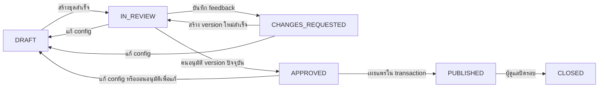

# แบบระบบ AwareFlow

## การปรับตามคำขอล่าสุด

ส่วนสร้างเนื้อหาปรับเป็น **Agent หนึ่งตัวที่ให้โมเดลเลือกเครื่องมือ** ตามเป้าหมายแล้ว ดู [AGENT.md](AGENT.md) สำหรับโค้ดและวงจรจริง `jobs.py` คุม lease/commit; `application/agent.py` คุมการเรียกเครื่องมือ; `OpenAILLM.decide_agent` เลือก action ผ่าน function calling เงื่อนไขอนุมัติและเผยแพร่ทั้งหมดด้านล่างยังคงใช้

## 1. ขอบเขตและการตัดสินใจ

FLOW.md เป็นข้อกำหนดผลิตภัณฑ์ ส่วนเอกสารนี้กำหนดโครงสร้างสำหรับ Sol ลงมือพัฒนาต่อ ใช้ Python + Streamlit + SQLite ตามข้อกำหนด เริ่มจากแอปเดียวที่แบ่งโมดูลชัดเจน ไม่ใช้ n8n และไม่เพิ่มหลาย Agent

ต้นแบบปัจจุบันมี Streamlit UI และรัน Mock Mode ครบวงจรแล้ว พร้อม OpenAI/Tavily/SMTP adapters ที่ทดสอบด้วย transport จำลอง, worker heartbeat/retry และ scheduler แบบต่อเนื่อง Company API ยังต้องเติม mapping ตามสเปกบริษัทและ authentication ยังเป็น demo selector ดูโครงสร้างจริงใน [CORE_GUIDE.md](CORE_GUIDE.md) และขอบเขตที่ยืนยันใน [IMPLEMENTATION_NOTES.md](IMPLEMENTATION_NOTES.md) ต้นไม้ด้านล่างเป็นแนวทางแบ่งหน้าที่ ไม่จำเป็นต้องแยกทุก service เป็นไฟล์ย่อยตามต้นไม้

| เรื่อง | ข้อตกลง |
|---|---|
| หน่วยงานหลัก | TrainingRound = รอบอบรม; TrainingVersion = บทอ่าน + ข้อสอบ + อ้างอิง + PDF ชุดเดียวกัน |
| การอนุมัติ | มนุษย์อนุมัติ version ที่ระบุชัดเจน ไม่อนุมัติเพียงชื่อรอบ |
| หลังเผยแพร่ | ตรึง version, เกณฑ์สอบ, กำหนดส่ง และรายชื่อผู้ได้รับมอบหมาย |
| เปลี่ยนหลังเผยแพร่ | สร้างรอบใหม่จากสำเนา หากพบข้อผิดพลาดให้ปิดรอบเดิมพร้อมบันทึกเหตุผล |
| ผู้ใช้ | ใช้ internal user ID เป็นหลัก อีเมลเปลี่ยนได้โดยไม่เปลี่ยนเจ้าของผลสอบ |
| การเก็บข้อมูล | SQLite เก็บสถานะทั้งหมด; file store เก็บ PDF/EML; session เก็บเฉพาะ UI state |
| ความล้มเหลว | เก็บใน jobs และ email_outbox แยกจากสถานะรอบ เพื่อ retry โดยไม่ลืมขั้นอนุมัติ |
| เวลา | แสดง/ตั้งรอบตาม Asia/Bangkok; บันทึก instant เป็น UTC รูปแบบเดียวกัน |
| การสอบซ้ำ | เก็บทุกครั้ง ครั้งล่าสุดเป็นผลปัจจุบัน ครั้งแรกใช้วิเคราะห์ก่อนทบทวน |

## 2. โครงสร้างโปรเจกต์เป้าหมาย

ต้นไม้ด้านล่างเป็น **โครงสร้างที่จะพัฒนา** ไม่ใช่รายการไฟล์ที่สร้างครบแล้ว แบ่งตามขอบเขตงานโดยให้ application services เป็นผู้ประสาน ไม่ให้หน้า Streamlit ประสาน provider เอง

```text
app.py                            # เริ่ม Streamlit และ navigation
src/awareflow/
  config.py                       # อ่าน env + validate safe defaults
  bootstrap.py                    # ประกอบ providers/repositories/services
  domain/
    models.py                     # Round, Version, Assignment, Attempt
    enums.py                      # สถานะและชนิดงาน
    schemas.py                    # validated content/settings/DTOs
    policies.py                   # transition, deadline, retake, visibility
    errors.py                     # domain errors ที่ UI แปลเป็นข้อความได้
  application/
    ports.py                      # interfaces ไม่ผูกกับ SDK ของผู้ให้บริการ
    rounds.py                     # สร้าง/แก้ config/clone/close
    generation.py                 # search → generate → validate → render
    review.py                     # feedback → revision → approval
    publication.py                # freeze + assignments + outbox transaction
    quizzes.py                    # authorization + deterministic grading
    reporting.py                  # คำนวณสถิติและส่งออก
    delivery.py                   # สั่งส่ง/ตรวจสถานะและจัดการ unknown
  infrastructure/
    db/                           # connection, migrations, repos, unit_of_work
    llm/                          # mock.py, openai.py, company.py
    search/                       # mock.py, configured_provider.py, fetcher.py
    pdf/                          # Thai renderer, templates, layout validation
    mail/                         # preview.py, smtp.py
    auth/                         # demo.py; จุดต่อ SSO ภายหลัง
    storage/                      # atomic writes, hashes, safe paths
    observability/                # structured logs + secret/PII redaction
  ui/
    navigation.py
    pages/                        # rounds, review, outbox, quiz, dashboard, settings
    components/                   # demo banner, status, errors, PDF preview
  worker.py                       # claim jobs + process + lease recovery
  scheduler.py                    # สร้างงานจาก schedule; ไม่เรียกผ่าน UI rerun
  cli.py                          # init-db, seed-demo, worker, scheduler
db/migrations/                    # ordered SQL migrations
assets/fonts/                     # Thai font + license จากแหล่งทางการ
templates/                        # lesson/report/mail templates
tests/
  unit/                           # policies, grading, metrics, validation
  integration/                    # SQLite transactions, outbox, jobs
  acceptance/                     # mock end-to-end ตาม FLOW.md
var/demo/                         # ignored: demo DB, PDFs, EML
var/real/                         # ignored: แยกจาก demo
docs/
```

ทิศทาง dependency เป้าหมาย: `ui/worker/scheduler → application → domain + ports`; infrastructure ประกอบที่ bootstrap Domain ไม่ import Streamlit, SDK, SMTP หรือ SQLite ห้าม UI ใช้ SQL โดยตรง รุ่น core ปัจจุบันใช้ SQL ใน application services ผ่าน Database unit of work เพื่อลดชั้นที่ยังไม่จำเป็น ดูข้อแตกต่างใน CORE_GUIDE.md

## 3. Workflow และสถานะ



- เริ่มสร้าง: บันทึกรอบ DRAFT และ job ก่อน แล้ว worker ค้นข้อมูล/เรียกโมเดล/สร้าง PDF นอก transaction ที่ล็อกฐานข้อมูล
- เมื่อพร้อมครบ: transaction ตรวจ `lock_version` ว่ารอบยังไม่ถูกแก้ จากนั้น insert immutable version และเปลี่ยน current version → IN_REVIEW
- แก้ config ก่อนเผยแพร่: เพิ่ม lock_version, กลับ DRAFT, ล้าง current version; เก็บ version/approval เก่าเป็นประวัติ งานเก่าที่กลับมาทีหลังต้องไม่ทับค่าใหม่
- ขอแก้ไข: feedback อ้างอิง current version เปลี่ยนเป็น CHANGES_REQUESTED และสร้าง job แก้บทอ่านกับข้อสอบทั้งชุด ไม่เขียนทับ version เดิม
- แก้สำเร็จ: version ใหม่มี parent version และ change summary กลับ IN_REVIEW เสมอ
- อนุมัติ: ตรวจว่าผู้ใช้มีบทบาท admin/reviewer, version ตรงกับหน้าที่ตรวจ, PDF และ validation ผ่าน จากนั้นบันทึก approval + actor + time
- เผยแพร่: อ่านรายชื่อกลุ่ม ณ เวลานี้และตรึง assignments, version, due_at, policy และ outbox ภายใน transaction เดียว ไม่เรียก SMTP ใน transaction
- ปิดรอบ: ไม่รับคำตอบเพิ่มแม้มีแบบฟอร์มเปิดค้าง และไม่ส่ง invitation ที่ยังค้าง; ดูรายงานย้อนหลังได้
- งานล้มเหลว: รอบคงสถานะเดิม แสดง job FAILED พร้อมข้อความที่ตัด secrets; retry ผ่าน job ใหม่หรือ retry เดิมตามนโยบาย ไม่ตั้งรอบเป็น ERROR จนสูญเสียสถานะการอนุมัติ
- กำหนดส่งไม่ปิดรอบอัตโนมัติ ต้นแบบอนุญาตส่งช้าจนปิดรอบและติดป้าย late หากต้องการ hard deadline ให้เพิ่มเป็นนโยบายในอนาคต

## 4. ข้อมูลและ transaction

Schema อยู่ที่ `db/migrations/0001_initial.sql` บังคับ FK/uniqueness และกติกาสำคัญ ส่วน schema validation, สิทธิ์ และ workflow guards อยู่ที่ application layer

| กลุ่มข้อมูล | หน้าที่ |
|---|---|
| users, user_groups, group_memberships | ตัวตนและสมาชิกกลุ่มปัจจุบัน |
| round_templates, schedules | ค่าเริ่มต้นสำหรับการสร้างรอบถัดไป ไม่ใช่ config ย้อนหลัง |
| training_rounds | config snapshot, สถานะ, current/published version และ optimistic lock |
| training_versions | immutable bundle JSON, source snapshot, config/policy snapshot, PDF path/hash |
| review_events | feedback, approval, rejection history แบบ append-only |
| assignments | ผู้ถูกมอบหมาย + version ที่ตรึง + recipient/name snapshot |
| attempts | คำตอบ คะแนน ครั้งที่สอบ และเวลา แบบ append-only |
| email_outbox | preview/delivery payload reference + transport + idempotency |
| jobs | งานเบื้องหลัง lease/retry/expected lock version |
| schedule_runs | กัน schedule เดิมสร้างรอบซ้ำในช่วงเวลาเดียวกัน |
| report_artifacts | ตัวเลข ณ เวลาออกรายงาน, narrative, PDF, provenance |
| audit_events | actor, action, target, timestamp; ไม่บันทึก secrets/เนื้อหาอ่อนไหวเกินจำเป็น |

เก็บ JSON สำหรับ content bundle และ answer map เพื่อลดจำนวนตารางในต้นแบบ ใช้ schema validator ก่อนบันทึกและตอนอ่าน พร้อม `schema_version` รายงานข้อที่ตอบผิดใช้โค้ดอ่าน JSON จาก attempts ของรอบนั้น ห้ามเชื่อ JSON จาก client ว่าเป็นคะแนนหรือเฉลย

SQLite ทุก connection ต้องเปิด foreign_keys, ตั้ง busy_timeout; พิจารณา WAL สำหรับไฟล์จริง ใช้ transaction สั้นและให้ worker เริ่มเพียงตัวเดียว โค้ดต้องรับมือ lock contention ทุก connection แยกกัน ไม่แชร์ connection ข้าม Streamlit sessions ไม่มี network call ใน transaction

ความครบถ้วนระดับ service:

1. `publish_round`: CAS status/lock → published version → assignments → preview outbox → audit ใน transaction เดียว
2. `submit_attempt`: BEGIN IMMEDIATE → ตรวจสิทธิ์/สถานะ/retake → ตรวจ submission key → ตรวจคำตอบ → grade → insert attempt → commit
3. `complete_generation`: ตรวจ lease + expected lock → insert version + review transition ใน transaction เดียว
4. PDF เขียน temp → atomic rename ด้วยชื่ออิง hash ก่อน commit version หาก commit ไม่ผ่านไฟล์จะเป็น orphan ที่เก็บกวาดได้ ห้ามลบไฟล์ที่มี version อ้างอิง
5. ระบบไม่ลบ users/rounds ที่มีประวัติ ใช้ปิดใช้งาน/ปิดรอบ แยกงาน retention และ deletion สำหรับขั้น production ภายหลัง

## 5. ค้นข้อมูลและสร้างเนื้อหา

SearchProvider แยกจาก LLMProvider เสมอ ผลค้นเก็บ URL, publisher/title, published_at, event_at, updated_at, retrieved_at และข้อความที่ใช้จริง วันที่ไม่ทราบเป็น null ห้ามใช้ retrieved_at/updated_at แทนวันที่ข่าว

ช่วงวันและ allowlist เป็น config ต่อรอบ Normalize hostname และกำหนดชัดว่าอนุญาต subdomain หรือไม่ ตัว fetcher ต้องตรวจ redirect และปลายทาง ห้ามเข้าถึง localhost/private networks; จำกัด timeout, ขนาด และชนิดไฟล์ รวมถึงตรวจทุก hop ของ redirect

ข้อมูลเว็บถือเป็นข้อความอ้างอิงที่ไม่เชื่อถือ ไม่ให้คำสั่งที่แฝงอยู่ในเว็บเปลี่ยนงานหรือเรียกเครื่องมือ ถ้าไม่มีข้อมูลเข้าเกณฑ์ให้ job เป็น NEEDS_INPUT และเสนอ evergreen review ผู้ดูแลต้องเลือกเองและ UI/PDF ต้องระบุว่าเป็นการทบทวน ไม่ใช่ข่าวใหม่

Model สร้าง structured bundle; โค้ดตรวจ 3–5 ข้อ, 4 ตัวเลือก, correct option เดียว, reference IDs และจุดในบทอ่านที่รองรับเฉลย ตรวจโครงสร้างไม่ได้ยืนยันความจริงทั้งหมด จึงยังต้องมีคนตรวจ

บทอ่านใช้ renderer ภาษาไทยและฟอนต์ที่มี license ตรวจการตัดคำ/วรรณยุกต์/การฝังฟอนต์จริง เป้าหมาย A4 หนึ่งหน้า ถ้าเกินให้ย่อหรือส่งกลับตรวจ ห้ามตัดข้อความ/อ้างอิงเงียบ ๆ รายงานหลายหน้าได้ เลือกไลบรารี PDF หลังทำ Thai rendering spike และอ่านเอกสารทางการ ผู้พัฒนาต้องแนบ license ของฟอนต์

## 6. อีเมลและการป้องกันงานซ้ำ

ค่าเริ่มต้น `preview` สร้าง EML/หน้า preview พร้อม PDF จริงและลิงก์ราย assignment โดยไม่ติดต่อ SMTP ป้าย PREVIEW ไม่เท่ากับ SENT

เมื่อเปิด SMTP ต้องผ่านสามเงื่อนไข: transport=SMTP, real-send flag=true, ผู้รับทุกคนอยู่ใน test allowlist ที่ normalize แล้ว ไม่มี CC/BCC ที่หลุดจากรายการ การเผยแพร่สร้างเฉพาะ invitation งานเตือนจะเป็น message_kind ใหม่ในอนาคต

ใช้ unique `(assignment_id, message_kind, transport)` และ message ID ที่คงที่ ป้องกันกดซ้ำ/rerun/worker claim ซ้ำ เปลี่ยนจาก preview เป็น SMTP เป็น action ชัดเจนที่สร้างแถว SMTP ไม่แปลง preview ให้ดูเหมือนส่งจริง

**SMTP รับประกัน exactly-once ไม่ได้** หาก SMTP อาจรับข้อความแล้วแต่ process ตายก่อนบันทึกผล หรือ timeout หลังส่ง DATA ให้เป็น UNKNOWN ไม่ retry อัตโนมัติ ให้ผู้ดูแลตรวจและเลือกยืนยันส่งแล้วหรือส่งซ้ำพร้อมบันทึกเหตุผล หาก error ยืนยันว่าไม่รับข้อความจึง retry แบบจำกัดได้ SMTP accepted หมายถึงเซิร์ฟเวอร์รับ ไม่ยืนยันว่าเข้ากล่องผู้รับ

Jobs มี lease token/expires_at และ attempt limit; reclaim งานส่งที่ค้างช่วงผลไม่แน่นอนต้องเป็น UNKNOWN ส่วนงาน pure generation retry ได้ Outbox status ไม่เกี่ยวกับ quiz status ผู้ที่ยังไม่ทำต้องเป็น NOT_STARTED ไม่ใช่ score=0

## 7. ตัวตนและหน้าข้อสอบ

DemoAuth แสดงทั้ง banner และ role selector ใช้ได้เฉพาะ APP_MODE=demo ห้ามให้ mode จริง fallback มาตัวเลือกนี้ ปุ่ม admin ทุกปุ่มเรียก service ที่ตรวจ role ซ้ำ การซ่อน navigation อย่างเดียวไม่ใช่ authorization

ลิงก์มี signed/opaque token ที่ผูก assignment, user, round, version, expiry และ token generation สำหรับ revoke/rotate ตรวจฝั่งเซิร์ฟเวอร์ทุกครั้ง Demo ต้องเลือก user ที่ตรงกับ assignment แม้มี token; production เปลี่ยนเป็น identity จาก SSO ห้ามเชื่อ user_id ใน URL หลีกเลี่ยง log token เต็ม

StudentQuiz DTO แสดงเฉพาะคำถาม/ตัวเลือก ไม่ส่ง correct_option, explanation หรือส่วนอ้างอิงเฉลยก่อน submit Streamlit session มีได้เฉพาะ draft answers/UI state; resume ผลสอบอ่านจาก DB

Retake policy ที่ใช้ในต้นแบบ:

- ไม่อนุญาตสอบซ้ำ: หลังส่งแสดงคะแนนและเฉลยเต็ม
- อนุญาตสอบซ้ำ: ระหว่างรอบเปิดแสดงคะแนน/ผ่านไม่ผ่าน และคำแนะนำทบทวนทั่วไป; ซ่อนเฉลยรายข้อจนปิดรอบ
- ไม่จำกัดครั้งสำหรับต้นแบบ แต่ป้องกัน concurrent duplicate ด้วย server-issued submission key และ transaction
- key ซ้ำ + payload เดิม → คืน attempt เดิม; key ซ้ำ + payload ต่าง → conflict ไม่แก้ผลเดิม
- เปิดหน้าสอบใหม่เพื่อ retake จึงออก submission key ใหม่ การ refresh หน้าผลต้องไม่สร้าง attempt
- due_at เป็น UTC instant; UI กรอกวันที่อย่างเดียวให้แปลเป็น 23:59:59 Asia/Bangkok ของวันนั้นและแสดงให้ผู้ดูแลเห็น
- `submitted_at <= due_at` คือทันกำหนด ใช้เวลาจากเซิร์ฟเวอร์

`localhost` ในลิงก์ใช้ได้บนเครื่องที่เปิดเซิร์ฟเวอร์เท่านั้น หากทดสอบหลายคนต้องตั้ง base URL ที่ทุกคนเข้าถึงได้และเปิดเซิร์ฟเวอร์ทิ้งไว้

## 8. นิยามรายงานที่ตกลงไว้

ตัวหารใช้ assignments ที่ตรึงตอนเผยแพร่ ไม่ใช้สมาชิกกลุ่มปัจจุบัน ใช้ attempt ล่าสุดของแต่ละ assignment เว้นแต่ metric ระบุครั้งแรก คะแนนเก็บทั้ง `correct_count` และ `question_count` คำนวณ pass ด้วย integer comparison `correct_count * 100 >= pass_percent * question_count` โดยไม่ปัดเศษก่อนตัดสิน

| Metric | นิยาม |
|---|---|
| assigned | จำนวน assignments ของรอบ |
| completed / not_started | assignments มี attempt อย่างน้อย 1 / ไม่มีเลย |
| passed / failed | ผ่าน / ไม่ผ่านจาก attempt ล่าสุด; ผลรวมเท่ากับ completed |
| completion rate | completed / assigned × 100 |
| pass rate | passed / completed × 100 |
| average score | ค่าเฉลี่ยเปอร์เซ็นต์ของ attempt ล่าสุด เฉพาะผู้ทำแล้ว |
| first-attempt average | ค่าเฉลี่ยเปอร์เซ็นต์ครั้งแรก เฉพาะผู้ทำแล้ว |
| on_time / late | ใช้เวลาของ attempt **ครั้งแรก** ว่าทำเสร็จทันกำหนดหรือไม่; รวมเท่ากับ completed |
| latest_on_time | ฟิลด์รายบุคคลเพิ่มเติม ไม่ปะปนกับจำนวนทำครบตรงเวลา |
| most missed | นับข้อผิดจาก attempt ล่าสุด 1 ครั้งต่อ assignment; แสดงจำนวน/ตัวหาร; เสมอกันแสดงทุกข้อ |

ถ้าตัวหารเป็นศูนย์แสดง “— / ยังไม่มีข้อมูล” และคืน null ใน DTO ไม่รายงาน 0% ที่ตีความผิด

รายปีจัดตามปีของ `published_at` ใน Asia/Bangkok รวมเฉพาะ PUBLISHED/CLOSED นับหน่วยเป็น `(round, user)` หรือ assignment ดังนั้นพนักงานหนึ่งคนทำ 12 รอบนับได้ 12 assignments แสดงจำนวน unique people แยกต่างหาก อัตรารวมคำนวณจากผลรวมตัวตั้ง/ตัวหาร ไม่เฉลี่ยเปอร์เซ็นต์ของแต่ละรอบ คะแนนเฉลี่ยถ่วงตามจำนวน completed assignments และยังเปิดรายละเอียดแต่ละรอบได้

`as_of` ต้องกรอง published_at, assigned_at และ submitted_at ไม่ให้รวมเหตุการณ์หลังเวลารายงาน เลือก first/latest จาก attempts ที่ผ่านตัวกรองแล้ว เก็บ metrics snapshot ลง report_artifacts เพื่อให้ PDF ที่ออกไปแล้วไม่เปลี่ยนตามผลสอบที่เข้ามาภายหลัง

ไม่รวมอันดับข้อผิดข้ามข้อสอบต่างชุดโดยอัตโนมัติ แสดงแยกตามรอบ/เวอร์ชัน รายงานย้อนหลังเป็นผล ณ `as_of` ที่สร้างรายงาน; dashboard แสดงข้อมูลปัจจุบัน ข้อมูลสาธิตกับจริงแยก DB และ storage จึงไม่รวมสถิติข้ามโหมด

CSV ใช้ UTF-8 BOM และป้องกัน spreadsheet formula injection ในช่องข้อความที่เริ่มด้วย = + - @ ฯลฯ PDF/CSV ใช้ metrics snapshot เดียวกัน AI สรุปจาก JSON ตัวเลขที่คำนวณแล้ว ไม่มีสิทธิ์แก้ metrics; หากสร้าง narrative ล้มเหลวหรือมีตัวเลขที่ไม่ตรงให้ใช้ template summary ที่ตรวจได้ ไม่ให้รายงานหลักล้มตาม AI

## 9. Scheduler และขั้นตอนขยายระบบ

เริ่ม manual workflow ก่อน Scheduler เป็น process แยกจาก Streamlit อ่าน schedules ใน Asia/Bangkok และสร้าง `schedule_runs(schedule_id, period_key)` แบบ unique พร้อมรอบ DRAFT/job ใน transaction เดียว ไม่อนุมัติหรือส่งเมลเอง

รายเดือนใช้ period key YYYY-MM รายปีใช้ YYYY ของช่วงที่ scheduler ทำงาน งานสร้างรายงานรายปีสร้าง report job และระบุ report_year แยกใน params (ค่าเริ่มต้นคือปีก่อนหน้าที่จบแล้ว); งานสร้างร่างสร้าง round จาก template snapshot เท่านั้น เลือกวันรายเดือนได้ 1–28 เพื่อลดความกำกวมของเดือนสั้น เปิดเครื่อง/เซิร์ฟเวอร์ไว้ตลอดช่วงที่ต้องทำงาน เมื่อกลับมาหลัง offline ต้นแบบสร้างเฉพาะช่วงปัจจุบันที่ถึงเวลารันแล้ว ช่วงที่ข้ามไปแจ้งผู้ดูแลให้ backfill ด้วยมือโดยใช้ idempotency key เดิม

ไม่ใช้ scheduler thread ที่เริ่มทุก Streamlit rerun ไม่บรรจุ credentials ใน schedule/config JSON เมื่อต้องขยายค่อยเปลี่ยน SQLite → PostgreSQL, worker → queue, file store → object storage, DemoAuth → SSO ผ่าน ports เดิม

## 10. ขอบเขตที่ยังไม่ใช่ production

ต้นแบบไม่ได้ยืนยัน SSO, deliverability, backup/restore, HA หรือการใช้พร้อมกันจำนวนมาก ก่อนเชื่อมระบบบริษัทต้องกำหนดสิทธิ์จริง, retention, การส่งข้อมูลเข้า model provider และ deployment ตามแนวทางบริษัท ประเด็นเหล่านี้ไม่ขวางการทำ Mock Mode ให้ครบก่อน
