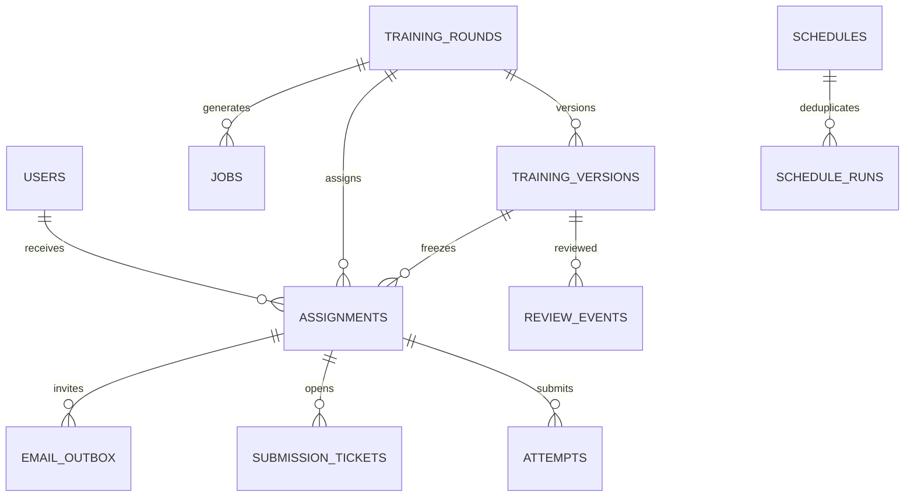

# คู่มือแกนระบบและ UI

เริ่มจาก `services = awareflow.bootstrap.build()` ใช้ชุด services นี้เป็นทางเข้าของ UI ไม่เขียน SQL/grade/approve ในหน้า Streamlit โค้ดปัจจุบันรวบรวมหน้าที่ที่เกี่ยวข้องไว้ด้วยกันเพื่อลดจำนวนชั้น จึงยังไม่แยก repository class ต่อ table

## แผนที่ไฟล์จริง

| ไฟล์ | หน้าที่ |
|---|---|
| `domain/models.py` | Typed models + structural validation + timestamps |
| `application/workflow.py` | สร้าง/แก้รอบ, enqueue, review, approve, publish, close |
| `application/agent.py`, `domain/agent.py` | Model-directed tool loop และ typed tool contracts; ดู AGENT.md |
| `application/jobs.py` | claim lease, รัน Agent, trace persistence, commit ด้วย lock version, retry |
| `application/quizzes.py` | learner projection, signed-link checks, tickets, grade, disclosure |
| `application/reporting.py` | round/annual metrics, as_of, CSV, immutable report snapshot |
| `application/delivery.py` | EML preview, ลิงก์/revoke, SMTP claim/lease/send/UNKNOWN resolution |
| `application/scheduling.py` | สร้าง schedule + monthly/yearly tick + annual report |
| `application/common.py` | authorization, command receipts, audit, state/lock guards |
| `application/ports.py` | Search/LLM/PDF interfaces สำหรับเปลี่ยน providers |
| `infrastructure/database.py` | connection ต่อ operation, BEGIN IMMEDIATE, migrations |
| `infrastructure/auth.py` | DemoAuth และ signed assignment links |
| `infrastructure/storage.py` | atomic content-addressed files + hash verification |
| `application/directory.py` | ผู้ใช้/กลุ่ม บริบทองค์กร และ audit แบบตรวจสิทธิ์ |
| `infrastructure/providers.py` | OpenAI Responses, Tavily, company factory และ LLM registry |
| `infrastructure/llm_base.py`, `http_llm.py` | shared authoring/JSON decisions และ Gemini/Claude/Ollama/compatible REST |
| `infrastructure/smtp.py` | SMTP TLS, allowlist และจำแนกผลส่ง |
| `ui/` | Streamlit navigation/forms/dashboard/learner เรียก services |
| `infrastructure/mock.py` | deterministic content; ไม่เรียกเครือข่าย |
| `infrastructure/pdf.py` | ฟอนต์ไทย + shaping + Thai word wrapping; lesson ไม่มีเฉลย |
| `config.py`, `bootstrap.py` | safe configuration และประกอบบริการ |
| `demo.py`, `cli.py` | fixture และคำสั่งรันจริง |

Application services ใช้ SQLite unit of work และ parameterized SQL โดยตรงในรุ่นนี้ การย้ายไปฐานข้อมูลอื่นจึงต้องแก้ส่วน persistence ใน services ด้วย ไม่อ้างว่ามี repository abstraction ครบแล้ว Domain models ไม่ขึ้นกับ SQLite/Streamlit

## ความสัมพันธ์ฐานข้อมูลหลัก



`assignments` เป็นจุดเชื่อมคน-รอบ-เวอร์ชัน ผลสอบจึงไม่อ้างอีเมลเป็นตัวหลักและไม่ต้องเก็บสถานะทำข้อสอบไว้ในตาราง users ทุกครั้งที่สอบเป็นแถวใหม่ใน attempts; status ปัจจุบันคำนวณจากครั้งล่าสุด ส่วนการส่งอีเมลอยู่คนละตาราง

`command_receipts` จำผลของคำสั่งแอดมิน; `submission_tickets` จำแบบฟอร์มของผู้สอบ; `schedule_runs` จำช่วงเวลาที่สร้างงานแล้ว ทั้งสามใช้ป้องกันซ้ำคนละขอบเขต ไม่ใช้ Streamlit session เป็นแหล่งข้อมูลหลัก

## เรียกใช้งานจากหน้าแอดมิน

```python
from awareflow.bootstrap import build
from awareflow.domain.models import RoundSettings

s = build()  # migrations/secret bootstrap รองรับการเริ่มพร้อมกัน
admin = s.auth.select_user("ADMIN")  # demo-only; แสดง banner ใน UI
settings = RoundSettings.model_validate(form_values)
round_id = s.workflow.create_round(admin, settings, key=create_key)
r = s.workflow.get_round(admin, round_id)
job_id = s.workflow.request_generation(admin, round_id, r["lock_version"], key=generate_key)
# UI แสดง jobs; worker process หรือปุ่ม explicit ประมวลผลเรียก run_once()
```

`form_values` และ keys มาจาก UI ที่จะพัฒนา ต้องสร้าง key หนึ่งครั้งต่อเจตนาการทำรายการแล้วเก็บจนทราบผล ห้ามออก key ใหม่ทุก rerun หรือทุก retry ของคำขอเดียวกัน ดูตัวอย่าง stable keys ใน `demo.py`

หลัง worker สำเร็จ:

```python
review = s.workflow.review(admin, round_id)
r, version = review["round"], review["version"]
# หน้า review ต้องใช้ bundle, sources, PDF ของ version เดียวกัน
s.workflow.approve_version(admin, round_id, version["id"], r["lock_version"], approve_key)
r = s.workflow.get_round(admin, round_id)
s.workflow.publish_round(admin, round_id, r["current_version_id"], r["lock_version"], publish_key)
s.delivery.prepare_previews(admin, round_id)
```

ขอแก้ใช้ `request_revision(actor, round_id, version_id, expected_lock, feedback, key)` แล้วรอ worker สร้าง version ใหม่ การแก้ settings ใช้ `update_round(...)` ซึ่งกลับ DRAFT และยกเลิกงานเก่าที่ค้างอยู่โดยเก็บประวัติเดิม

ค่าที่ต้องอ่านจากหน้าที่ผู้ใช้เห็นคือ `expected_lock` และ `version_id` ไม่อ่านค่าล่าสุดเงียบ ๆ ตอนกดอนุมัติ เพราะจะทำให้ผู้ใช้อนุมัติฉบับที่ยังไม่ได้ดู เมื่อ Conflict ให้โหลดหน้าตรวจใหม่

## หน้าผู้สอบ

```python
learner = s.auth.select_user(selected_demo_user)
quiz = s.quizzes.get_student_quiz(learner, token_from_url)
pdf_bytes = s.quizzes.lesson_pdf(learner, token_from_url)
key = s.quizzes.begin_submission(learner, quiz["assignment_id"])
result = s.quizzes.submit_attempt(learner, quiz["assignment_id"], key, answers_by_question_id)
```

อย่าใช้ `workflow.review` หรืออ่าน ContentBundle ในหน้า learner `get_student_quiz` คืนเฉพาะ fields ที่อนุญาต ไม่มีเฉลย; `lesson_pdf` ตรวจทั้งตัวตน token และ file hash ก่อนคืนไฟล์ ใช้ download control ที่ตรวจ auth ไม่เปิดทั้ง data directory เป็น static files

เมื่อเปิดหน้าผล เรียก `get_result` หากยังไม่ทำจะได้ NOT_STARTED และ score=null `begin_submission` คืน ticket ที่ยังไม่ใช้เดิมข้าม restart; หลังใช้แล้วกดเริ่มสอบซ้ำอย่างชัดเจนจึงเรียกเพื่อรับ ticket ใหม่

ห้าม cache ผลของ AuthProvider, quiz หรือ report รวมข้ามคนด้วย cache key ที่ไม่รวม identity อย่าให้หน้า UI สร้าง Actor จาก user_id ที่รับจาก URL โดยตรง การเลือกตัวตนทำได้เฉพาะ demo; production ต้องเปลี่ยน AuthProvider ก่อน

## รายงานและ scheduler

`round_metrics(actor, round_id)` และ `annual_metrics(actor, year)` คำนวณข้อมูลปัจจุบัน ใส่ `as_of` เป็น datetime มี timezone เมื่อต้องการกรองย้อนหลัง `export(actor, key, round_id=...)` หรือ `export(actor, key, year=...)` คืน PDF/CSV และ metrics snapshot เดียวกัน key ใหม่หมายถึงตั้งใจออกรายงานใหม่ ส่วน key เดิมคืน snapshot เดิม

```python
s.scheduling.create_schedule(
    admin, key="schedule-phishing-monthly-v1", name="อบรมประจำเดือน",
    kind="DRAFT_MONTHLY", settings=settings, day=1, hour=9,
    lookback_days=90, due_days=14,
)
# จาก process ภายนอก Streamlit:
s.scheduling.tick()
s.worker.run_once()
```

รายปีใช้ `DRAFT_YEARLY` หรือ `REPORT_YEARLY` และระบุ `month` ด้วย รายงานรายปีเลือกปีก่อนหน้าที่จบแล้ว งานร่างสร้างได้เพียงรอบเดียวต่อ schedule/period โดยคงขั้นอนุมัติคน ต้องเรียก tick/worker ซ้ำจาก cron หรือ process runner บนเครื่องที่เปิดอยู่ ยังไม่มี service installer สำหรับ scheduler

## ขอบเขต transaction

- **publish:** เปลี่ยนสถานะ + assignments + outbox + receipt + audit commit พร้อมกัน หากเขียนหนึ่งแถวไม่ผ่าน rollback ทั้งหมด
- **submit:** lock DB → auth → ticket replay check → ตรวจ state/policy/answers → grade → attempt + consume ticket + audit commit พร้อมกัน
- **generation:** claim job → เรียก provider/render นอก transaction → ตรวจ lease+lock อีกครั้ง → version + IN_REVIEW + completed job commit พร้อมกัน
- **รายงาน:** read snapshot เดียว → render นอก transaction → persist report + receipt; กดซ้ำคืน snapshot เดิม
- **scheduled draft:** schedule_run + round + job ใน transaction เดียว; scheduled report ใช้ export receipt กัน crash ก่อนบันทึก schedule_run

## Errors

จับ `WorkflowError` และ Pydantic `ValidationError` ที่ UI แล้วแสดงข้อความที่เหมาะสม อย่าแสดง provider exception/raw headers งาน worker เก็บเพียง error code และ safe message ไม่มี API keys ใช้ `worker.retry(actor, job_id, key)` สำหรับ FAILED ที่ยังไม่ครบจำนวนครั้ง NEEDS_INPUT ให้แก้ settings และเริ่มใหม่ หลังครบจำนวนครั้งต้องแก้/เริ่มงานใหม่โดยผู้ดูแล ไม่ retry ไม่จำกัดอัตโนมัติ

## หน้าเว็บและกระบวนการเบื้องหลัง

`app.py` เรียก `ui/app.py` และ cache ชุด services; session เก็บ actor selection/form state เท่านั้น หน้า `admin.py`, `settings.py`, `learner.py` ไม่เขียน SQL โดยตรง ใช้ command keys และ version lock ของหน้าที่ผู้ใช้เห็น เมื่อสำเร็จจึงสร้าง key ใหม่

`cli worker` และ `cli scheduler` เป็น process ต่อเนื่องแยกจากหน้าเว็บ UI มีปุ่มประมวลผลครั้งเดียวสำหรับ demo ตั้งค่าและวิธีรันใน [README](../README.md) `APP_MODE=demo` ยังใช้เมื่อทดสอบ provider จริง จึงไม่อ้างว่าการใส่ API key ทำให้ authentication เป็น production

Migration 0003 เพิ่ม app_settings และ unique open submission ticket; migration runner ตรวจเวอร์ชันภายใต้ BEGIN IMMEDIATE ทุกครั้ง การอัปเดต schema ไม่ล้างผลเดิม

Migration 0004 เพิ่ม agent_steps ที่ผูก job/attempt/step; training_versions.validation_json ระบุ agent_job_id/agent_attempt เพื่อเปิดประวัติชุดที่ตรวจ ร่างเก่าไม่มี trace ยังอ่านได้ตามเดิม
